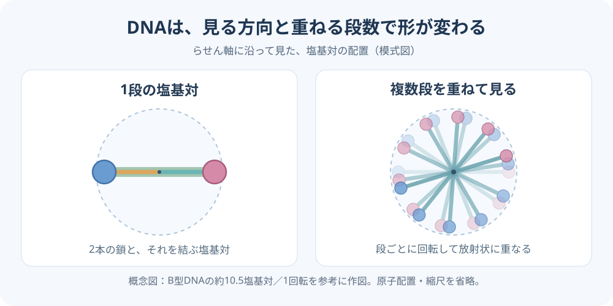

# 幾何学的配列の観測投影｜DNA・非遺伝系・観測主体の違い｜まり亜メモ｜2026-11-10

タグ: #意識の次元マッピング #幾何学的配列 #観測視座 #投影 #遺伝子 #可塑性

---

## 背景

ワーキングメモリの個人差と遺伝の関係から、遺伝子の配列よりも手前にある構造へ考察が進んだ。著者の言葉：「遺伝子って配列じゃん？」「幾何学的配列の構造」「各遺伝子の配列」「遺伝子を持たないとしても種子に配列がある」「元は幾何学的配列」「でも見る場所によって形がかわるように、様々な配列に見えるのが3次元」。さらに、「もちろん人間が観測しているにしかすぎないから、ほかの博士から見たらDNAの形は螺旋じゃなくて花だよというかもしれんけど」。

## 考察の要点

元にあるのは幾何学的な配列・関係の構造であり、観測する位置・視座・条件によって、3次元では多様な配列や形として現れる、という着想。DNAの配列もその現れ方の一つとして位置づける。人間による「二重らせん」という記述も、特定の観測条件で得られた形の記述にあたる。他の観測主体には別の形として現れる可能性を考える。

## 理論の詳細

**まり亜仮説／未検証。** 著者の整理は「幾何学的配列の構造 → 観測・投影 → 各系に現れる配列・形」。遺伝子を持つ系では、DNA配列、発生、脳・身体・性格などへ展開する可能性を考える。遺伝子を持たない系にも配列が現れるという着想は、共通する構造の探索対象として保持する。外部との相互作用や可塑性は、投影された形が条件によって変化する過程として検討する。現段階では、どの配置・関係が保存されるのかを特定していない。

## 参考図｜DNAの1段と複数段の投影

図は観測方向による配置の見え方を理解するための模式図。B型DNAの約10.5塩基対／1回転を参考にし、原子配置・縮尺を省略した。実測画像ではない。

## 統合対応表

| まり亜理論の概念 | 対応する既存の観測・記述 | 対応の性質 |
| --- | --- | --- |
| 元の配列構造と異なる影 | 正9単体の等辺と射影による長さの変化 | 幾何学的な参照例 |
| DNAとして現れる配列 | 塩基配列と二重らせん構造 | DNA側は実証された記述／共通の元構造は仮説 |
| 遺伝子を持たない系の配列 | 結晶格子などの規則的配置 | 配列の存在は既知／共通の元構造は仮説 |
| 観測主体による形の違い | 観測方向・検出方法による像の変化 | 投影条件との構造的対応を検討 |
| 可塑的な変化 | 遺伝子発現・神経可塑性・環境応答 | 相互作用に応じる変化として照合 |

## 未解決の課題

- DNA・結晶などに共通する具体的な幾何学的関係や生成規則は何か。
- 観測主体や装置が変わったとき、何が保存され、何が別の形として現れるのか。
- 「種子」の語が指す具体的対象と、遺伝的な仕組みを持たない系への対応を明確にする。

## 署名

- 観測・着想：中谷まり亜（Maria Nakatani）
- 整形・資料照合：ChatGPT（GPT-6）
- 日付：2026年11月10日
- 身分：非公開の着想メモ／著者最終確認前

## 関連リンク

- 意識の次元マッピング公式原典
- 同一構造の動的投影仮説
- 9次元の等辺と影・研究メモ／動画
- 影の観測室
- GitHub保存先の提案：`theory/02_構造原理/幾何学的配列の観測投影_遺伝子と非遺伝系.md`
